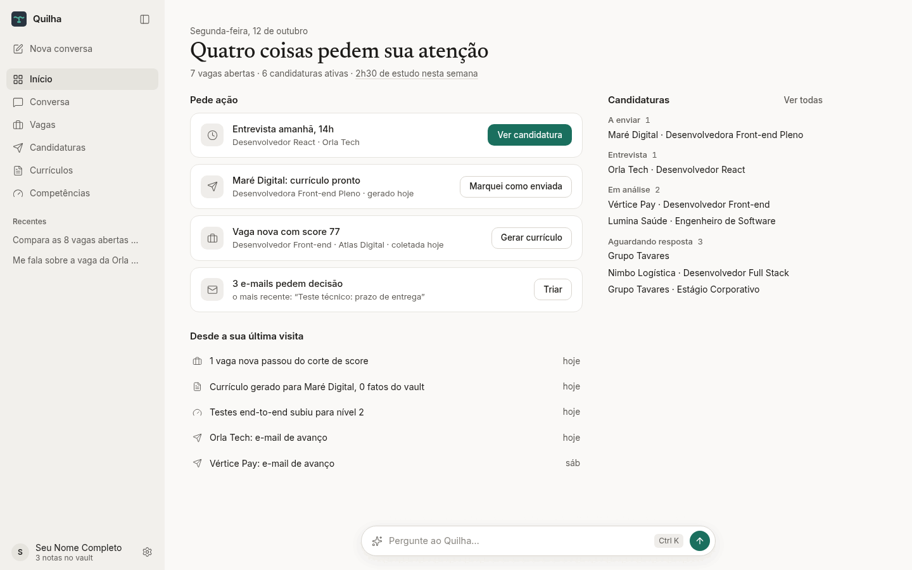
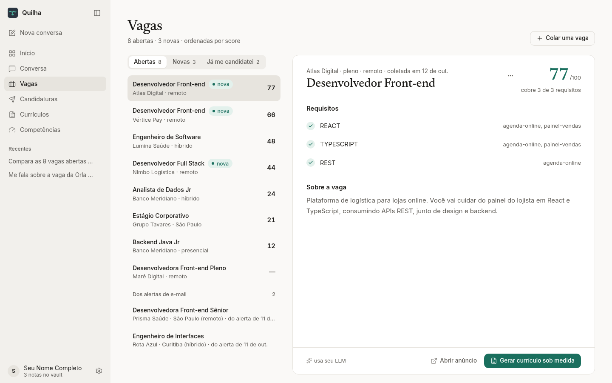
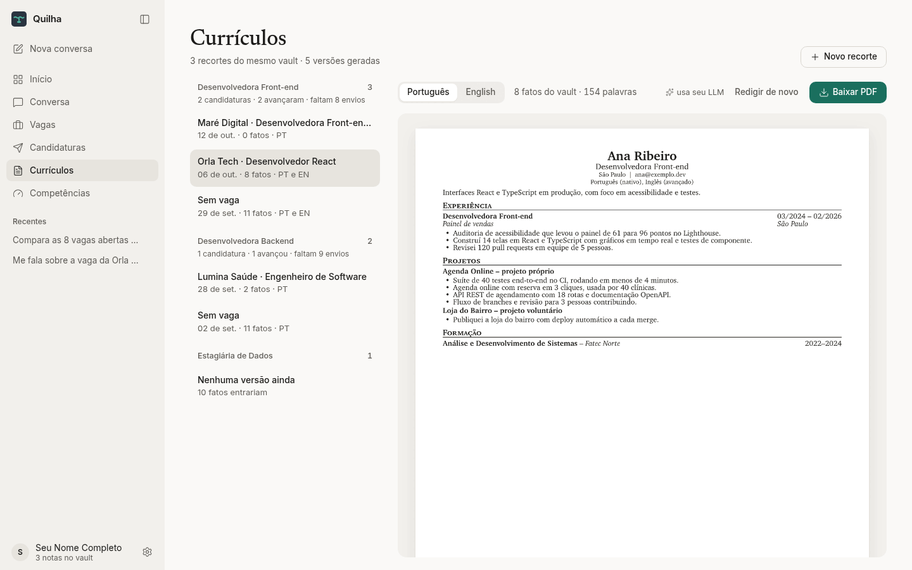
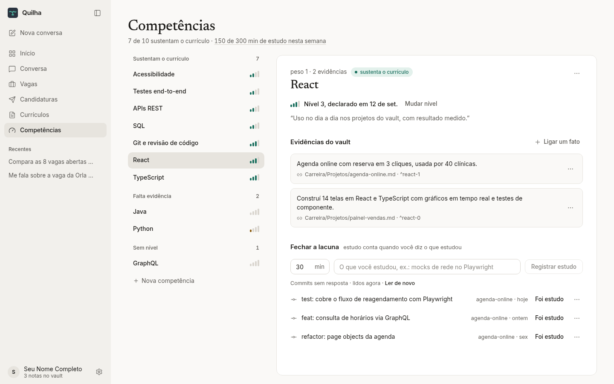
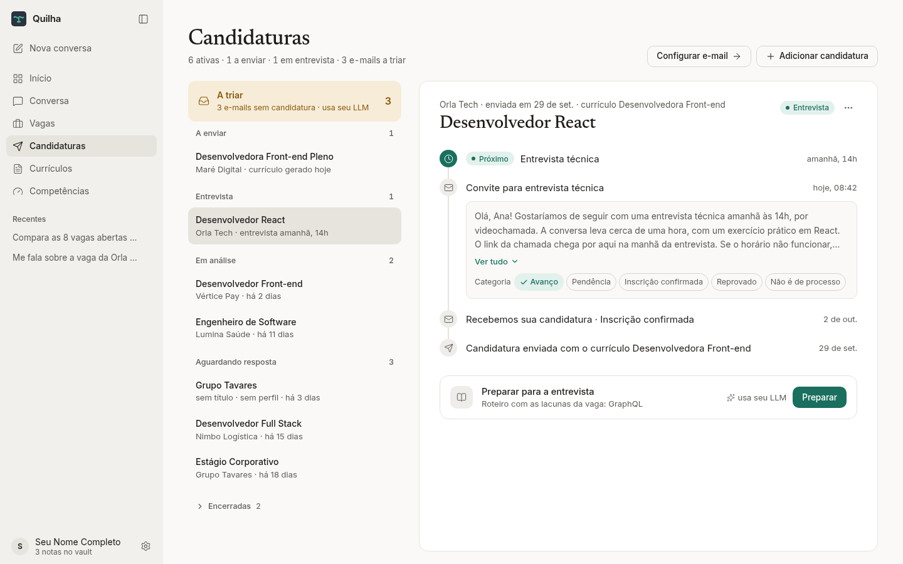

<p align="center">
  
</p>

<h1 align="center">Quilha</h1>

<p align="center">
  Seu agente de carreira, local e sem inventar nada.<br>
  Ele avalia vagas, gera currículo sob medida a partir do que você de fato fez<br>
  e acompanha candidaturas, entrevistas e estudos.
</p>

<p align="center">
  <a href="#instalar">Instalar</a> ·
  <a href="#primeiros-passos">Primeiros passos</a> ·
  <a href="#para-quem-desenvolve">Para quem desenvolve</a> ·
  <a href="LICENSE">Licença MIT</a>
</p>

<picture>
  <source media="(prefers-color-scheme: dark)" srcset="design/telas/inicio-escuro.png">
  
</picture>

## O que o Quilha faz

O Quilha parte de uma regra: **todo o seu currículo precisa ter fonte.** Você anota o que fez em notas
Markdown (um [vault](#primeiros-passos), que pode ser do Obsidian), com cada fato numa linha. Daí em diante:

- **Vagas:** cole uma vaga ou deixe o coletor buscar nas páginas de carreira (Greenhouse, Lever, Gupy). O
  modelo lê os requisitos; a **nota de 0 a 100 é calculada pelo código**, a partir do que você comprova.
- **Currículos:** gera o currículo em português e em inglês, em PDF, escolhendo só fatos que sustentam suas
  competências. Cada linha aponta para o fato do vault de onde saiu; o modelo reescreve o texto, mas não
  acrescenta nada.
- **Competências:** você declara o seu nível em cada uma, e o Quilha recusa o nível que as evidências do vault
  não sustentam, dizendo o que falta.
- **Candidaturas:** lê os e-mails das empresas (Gmail ou IMAP), separa avanço, pendência e reprovação, liga
  cada um à candidatura certa e mostra a próxima entrevista. Com o tempo, diz qual recorte de currículo está
  funcionando.
- **Estudos:** registra o que você estudou, usa seus commits como lembrete e monta o plano da semana a partir
  das lacunas das vagas.
- **Conversa:** um chat que consulta tudo isso e só grava depois que você confirma.

<table>
  <tr>
    <td width="50%">
      <picture>
        <source media="(prefers-color-scheme: dark)" srcset="design/telas/vagas-escuro.png">
        
      </picture>
      <p align="center"><b>Vagas</b>: a nota mostra de onde veio</p>
    </td>
    <td width="50%">
      <picture>
        <source media="(prefers-color-scheme: dark)" srcset="design/telas/curriculos-escuro.png">
        
      </picture>
      <p align="center"><b>Currículos</b>: recortes por cargo, em PT e EN</p>
    </td>
  </tr>
  <tr>
    <td width="50%">
      <picture>
        <source media="(prefers-color-scheme: dark)" srcset="design/telas/competencias-escuro.png">
        
      </picture>
      <p align="center"><b>Competências</b>: nível só com evidência</p>
    </td>
    <td width="50%">
      <picture>
        <source media="(prefers-color-scheme: dark)" srcset="design/telas/candidaturas-escuro.png">
        
      </picture>
      <p align="center"><b>Candidaturas</b>: os e-mails viram linha do tempo</p>
    </td>
  </tr>
</table>

**Seus dados ficam com você.** Vault, banco e currículos ficam no seu computador. O app só fala com a
internet para o que você pedir: o provedor de LLM que você escolher (com a **sua** chave, ou um modelo local
via Ollama), a sua caixa de e-mail e as páginas de vagas. Termos que nunca podem sair da máquina (nome de
cliente, sistema interno) vão numa denylist, e o comando que os encontrar não envia nada.

**Custo:** quase tudo roda offline e de graça. Só gastam crédito do seu provedor a conversa, a redação do
currículo, a leitura de requisitos de uma vaga, a triagem de e-mails novos e o plano de estudos; o app avisa
antes ("usa seu LLM") e há um teto por turno (`HERMES_MAX_COST_USD`).

## Instalar

Baixe o instalador do seu sistema na página de **Releases** do repositório:

| Sistema | Arquivo |
|---|---|
| Linux | `.AppImage` (qualquer distro: dê permissão de execução e abra) ou `.deb` (Debian/Ubuntu) |
| Windows | `-setup.exe` ou `.msi` |
| macOS | `.dmg` — `aarch64` para Apple Silicon (M1 em diante), `x64` para Intel |

Não precisa de Python, Node nem nada instalado: o app leva tudo junto. Na primeira abertura ele pede a pasta do
vault (ou cria uma com uma nota de exemplo) e, se você quiser os recursos com IA, a chave do seu provedor de LLM.

Os instaladores ainda **não são assinados**, então o sistema avisa na primeira vez:
- **Windows (SmartScreen):** "O Windows protegeu o computador" → **Mais informações** → **Executar assim mesmo**.
- **macOS (Gatekeeper):** "não pode ser aberto porque é de um desenvolvedor não identificado" → clique com o botão
  direito no app → **Abrir** → **Abrir**. Se o macOS disser que o app "está danificado", rode
  `xattr -dr com.apple.quarantine /Applications/Quilha.app` no Terminal.

Configuração, banco e currículos gerados ficam na pasta de dados do usuário, nunca dentro do app:

| Sistema | Pasta |
|---|---|
| Linux | `~/.local/share/quilha` |
| Windows | `%LOCALAPPDATA%\quilha` |
| macOS | `~/Library/Application Support/quilha` |

`HERMES_HOME` muda essa pasta. Se algo não funcionar, `quilha-backend diagnostico` (dentro da pasta do app)
confere caminhos, banco e PDF sem gastar nada; o log do backend fica na pasta de logs do app.

## Primeiros passos

Na primeira abertura, o app pede a pasta do vault. Se você ainda não tem uma, ele cria uma com uma nota de
exemplo. Depois disso, a tela de Configurações guia o resto: a chave do seu provedor de LLM (ou um modelo
local), a caixa de e-mail e as fontes de vagas. O tour da primeira vez mostra onde fica cada coisa.

### Montando o vault

Qualquer pasta de Markdown serve; o Obsidian só deixa a navegação melhor. O Quilha lê **só** `Carreira/`
(subpastas à vontade, `Templates/` é ignorada). Cada nota é um emprego (`type: experience`) ou um projeto
(`type: project`):

```markdown
---
type: project
id: meu-projeto-api            # estável: é o que curriculos.yaml e as evidências citam
nome: Meu Projeto API          # em experiência, `empresa:` no lugar de `nome:`
subtitulo: {pt: "API de agendamentos", en: "scheduling API"}
stack: [python, fastapi, postgresql]
link: https://github.com/voce/meu-projeto-api
inicio: 2026-03
---

# Meu Projeto API

## Fatos

- API REST em FastAPI com autenticação JWT e 42 testes, medidos em 10/2026 #python #api ^api-rest
- Schema PostgreSQL escrito à mão, com constraints CHECK #sql ^schema
```

Regras que o `hermes check` cobra:
- **Todo fato termina num block id** (`^algum-id`), único na nota. É ele que o currículo cita.
- **Número precisa de fonte:** N, data ou período no próprio fato. Sem isso, aviso.
- Experiência aceita também `cargo`, `fim` (ou `atual`) e `local`, que vão para o cabeçalho da entrada.
- `Perfil.md` na **raiz** do vault (fora de `Carreira/`) guarda nome, contato e formação do cabeçalho.
  `hermes cv draft` mostra o template se ele não existir.
- `denylist.yaml` (copie de `denylist.example.yaml`) lista termos que nunca podem ir para uma API de LLM —
  nome de cliente, sistema interno. Se um aparecer numa nota, o comando falha.

## Para quem desenvolve

O pacote Python e a CLI ainda se chamam `hermes`: o app desktop é uma casca sobre a mesma API
local, e tudo que ele faz também existe na linha de comando.

### Como funciona

O **vault Obsidian é a fonte da verdade** (`~/Obsidian` por padrão; veja [Montando o vault](#montando-o-vault)).
Uma nota por emprego ou projeto, com frontmatter e uma seção `## Fatos`; cada fato termina num block id
(`^algum-id`), que é o identificador estável citado pelo currículo.

O **SQLite é a verdade operacional** (vagas, competências, avaliações, sessões de estudo, execuções). A tabela
`facts` é a única exceção: é índice do vault e pode ser apagada e reconstruída a qualquer momento.

```
Obsidian/Carreira/**.md  →  hermes index  →  facts (descartável)
                                              ↕ evidence (não descartável)
                                            competencies · jobs · study_sessions · runs
```

### Rodando do código

Para rodar a partir do código (CLI completa, sem o instalador):

```bash
git clone https://github.com/Eduardozsw/quilha.git && cd quilha
uv sync
cp .env.example .env          # ajuste VAULT_PATH se o vault não estiver em ~/Obsidian
uv run hermes check           # valida o vault
uv run hermes index           # constrói o índice de fatos
uv run hermes comp seed       # carrega a taxonomia de competencias.yaml
uv run hermes stats           # o que há no banco
```

Requer [uv](https://docs.astral.sh/uv/) e Python 3.11+. Todos esses comandos rodam offline e sem custo.

Para chamar `hermes` de qualquer pasta, sem `uv run`:

```bash
uv tool install --editable .
```

Editável de propósito: rodando do código, a configuração, o banco e a denylist são resolvidos contra a raiz do
repositório (`hermes/caminhos.py`), então uma instalação normal criaria o banco dentro do venv da ferramenta.
O app desktop e o instalador: `desktop/README.md`.

### Comandos

| Comando | O que faz | Custo |
|---|---|---|
| `hermes check [--strict]` | Valida frontmatter, block ids, número sem fonte, denylist e evidência órfã | zero |
| `hermes index` | Reconstrói `facts` a partir do vault, numa transação | zero |
| `hermes stats` | Fatos indexados, competências e últimas execuções | zero |
| `hermes comp seed` | Carrega a taxonomia de `competencias.yaml` (idempotente por slug) | zero |
| `hermes comp list [--lacunas]` | Nível vigente e evidências por competência | zero |
| `hermes comp evidence <slug> <ref> [--remover]` | Liga (ou desliga) uma competência a um fato do vault | zero |
| `hermes comp assess <slug> <nível> -j "..."` | Declara seu nível — recusado sem evidência que sustente | zero |
| `hermes comp show <slug>` | Nível, justificativa e evidências | zero |
| `hermes comp coverage` | O que sustenta currículo e o que é lacuna | zero |
| `hermes comp niveis` | A escala 0–4 e o que cada nível exige | zero |
| `hermes comp export` | Escreve `Competencias.md` no vault (espelho só de leitura, com links para os fatos) | zero |
| `hermes backup [--destino] [--manter 10]` | Cópia do banco em `data/backups/` (ou `HERMES_BACKUP_DIR`) | zero |
| `hermes chat [pergunta]` | Conversa com o agente. Sem argumento, abre o REPL | **paga** |
| `hermes cv draft [-i pt] [-i en] [--job <id>] [--perfil <slug>] [--forcar]` | Gera o currículo a partir dos fatos que sustentam nível ≥ 2; seleção igual a uma já redigida é reaproveitada sem custo | **paga** |
| `hermes cv pdf [-i pt] [--perfil <slug>] [--job <id>]` | O mesmo que `cv draft` e mais o PDF (Typst). Passou do limite de páginas do perfil: sai com 1 e diz o que ocupa mais | **paga** como `cv draft`; zero se reaproveitar |
| `hermes cv perfis` | Perfis de `curriculos.yaml` (copie de `curriculos.example.yaml`) e quantas versões cada um já tem | zero |
| `hermes serve [--port 8765]` | API local do app desktop, só em 127.0.0.1, exige o token de `HERMES_API_TOKEN` | zero |
| `hermes job add [arquivo \| -] [--url URL]` | Grava a vaga e extrai os requisitos. Vaga repetida não chama o modelo | **paga** (1 chamada) |
| `hermes job extrair <id>` | Extrai (ou refaz) os requisitos de uma vaga gravada, a partir do texto guardado | **paga** (1 chamada) |
| `hermes job list` / `job show <id>` | Vagas com o último score / requisitos e mapeamento | zero |
| `hermes job map <requisito> [slug]` | Corrige o mapeamento de um requisito (sem slug, desfaz) | zero |
| `hermes job match <id> [--sem-texto]` | Score v1, lacunas e riscos de entrevista | **paga** (1 chamada); zero com `--sem-texto` |
| `hermes study log <min> "o que fez" [-c slug]` | Registra uma sessão de estudo que você fez | zero |
| `hermes study week [--semana 2026-W39]` | Minutos da semana por competência, contra o plano | zero |
| `hermes study git [--dias 1]` | Commits recentes dos seus repositórios como **sinal** | zero |
| `hermes study confirm <ids> <min> "o que fez"` / `study ignore <ids>` | Commits viram uma sessão com o que você declarou / saem da lista | zero |
| `hermes job collect [--forcar] [--extrair N]` | Coleta vagas das fontes de `fontes.yaml` (Greenhouse, Lever, Gupy) | zero; `--extrair` paga 1 chamada por vaga |
| `hermes job fila` | Estado da fila do coletor: falhas seguidas e próxima tentativa | zero |
| `hermes email sync [--dias 30] [--max 200] [--rotular]` | Lê o Gmail, classifica os e-mails novos (LLM do usuário ou Jev) e liga às candidaturas | **paga** (1 chamada por e-mail novo) |
| `hermes email testar` | Conecta na caixa de `EMAIL_ORIGEM` (Gmail ou IMAP) e conta os e-mails da semana | zero |
| `hermes email pendentes` / `email ligar <e> <c>` / `email corrigir <e> <cat>` | Revisão do que o Quilha não ligou sozinho | zero |
| `hermes email avaliar` | Acurácia da triagem contra as suas correções | zero |
| `hermes app list [--status] [--pingadas]` / `app add` / `app perfil <id> <slug>` / `app cancelar <id>` | Candidaturas: o que foi enviado e com qual perfil | zero |
| `hermes app notas` | Nota 0–5 de cada perfil pela taxa de avanço | zero |
| `hermes mcp list` | Servidores de `mcp.yaml`, as tools de cada um e o que está liberado | zero |
| `hermes mcp call <tool> '{json}'` | Chama uma tool MCP liberada, sem LLM | zero |
| `hermes study plan -m <minutos>` | Plano da próxima semana a partir das lacunas das vagas; acrescenta em `Diario/` se você confirmar | **paga** (1 chamada) |

Sem `pergunta`, abre a conversa interativa (saia com Ctrl-D ou
`sair`); `--continue` retoma a última sessão; `--max-cost` sobrepõe o teto de `HERMES_MAX_COST_USD`, que
aborta o turno e grava a execução como `partial`. Toda gravação pede confirmação no terminal — `--yes`
dispensa, e é aí que você deixa de revisar o que vai para o vault e para o banco.

`cv draft` faz uma chamada por idioma e **seleciona os fatos uma vez só** — PT e EN afirmam exatamente
os mesmos fatos, por construção. O código escolhe quais fatos entram e escreve a origem de cada bullet
(`<!-- ^block-id @ nota.md -->`); o modelo só reescreve o texto. Referência que o modelo inventar é
descartada com aviso, e o fato entra com o texto original do vault. Precisa de `Perfil.md` na raiz do
vault (nome, contato, formação) — o comando mostra o template se ele não existir.

Cada geração grava `cv-<idioma>.md` e `cv-<idioma>.json`, os dois saídos da mesma estrutura. Cargo,
datas, local, stack, link e `subtitulo` (texto ou `{pt, en}`) vêm do frontmatter das notas; as linhas de
Habilidades e os nomes de exibição da stack, do `curriculos.yaml`. O banco guarda só a **redação** do
modelo: mudar um cabeçalho no vault e gerar de novo remonta o currículo sem chamar o modelo.

`cv pdf` passa o JSON pelo template `hermes/templates/cv.typ` (fonte XCharter, dentro do projeto; nada
depende de fonte do sistema) e confere as páginas. Passou de `paginas` do perfil (padrão 1): o PDF fica
gravado para você ver, o comando sai com 1 e lista as entradas da maior para a menor, em linhas. O
código não corta nada sozinho. `hermes check` avisa item de Habilidades que nenhuma nota sustenta
(stack ou tag de fato): declaração não é fato.

#### Estudos: você declara, o commit só pergunta

Estudo é o que você declara (`study log`, ou o chat com `log_study`). `study git` lê `git log` dos
repositórios em `HERMES_REPOS_DIR` (padrão `~/Projetos`), só com commits cujo autor é o `user.email` do
repositório, e grava cada um em `activity_signals`. Nenhum commit vira `study_session` sozinho: `study
confirm` junta os commits que você indicar em **uma** sessão, com os minutos que **você** disser, e cada
sinal guarda o id da sessão.

`study plan` pega as competências que as vagas abertas pedem e que estão abaixo do nível 2, mais o que você
declarou na semana anterior, e pede ao modelo um plano. O código recusa competência que não é lacuna, corta o
que passa dos minutos disponíveis e liga cada item à vaga que o originou. O plano vai para o banco; para
`Diario/<semana>.md` só depois de você ver o trecho inteiro e confirmar. O Quilha só escreve em `Diario/` e
`Estudos/`, e só acrescenta: nunca reescreve uma nota.

No chat, `log_study` e `git_activity` gravam sem perguntar (baixo risco, muito atrito). A lista fica em
`HERMES_SEM_CONFIRMACAO`; `--yes` dispensa todas as confirmações.

#### Coletor: fila, backoff e agendamento

`job collect` lê `fontes.yaml` (copie de `fontes.example.yaml`) e consome as APIs públicas de vagas da
Greenhouse e da Lever. A Gupy não tem API pública, mas a página de carreiras (`<empresa>.gupy.io`) é
Next.js renderizado no servidor: a lista de vagas e a descrição de cada uma vêm no JSON `__NEXT_DATA__` do
HTML, então não precisa de navegador. É uma requisição para a lista e uma por vaga que passou no filtro e
ainda não está no banco, com 1 s de pausa entre elas e no máximo 25 por fonte e execução (o resto fica para a
próxima, com aviso). Vaga "banco de talentos" é ignorada. Uma página de vaga que falha vira aviso; só quando
todas falham a fonte falha. Cada fonte tem uma linha em `fila_coleta`, que sobrevive entre execuções:

- **Intervalo:** fonte coletada com sucesso só volta depois de `intervalo_h` horas (padrão 24).
- **Retry dentro da execução:** timeout de 15 s e até 2 novas tentativas em erro de rede ou 5xx. 4xx não se
  repete.
- **Backoff entre execuções:** fonte que falhou espera 15 min, depois 30 min, 1 h… até 12 h. A partir de 5
  falhas seguidas o aviso pede para conferir o board. Um sucesso zera a contagem.
- **robots.txt:** lido uma vez por host e execução. Se proíbe, a fonte fica `bloqueada` e a API não é chamada;
  se não dá para ler, a fonte conta como falha (não se presume permissão). A Gupy serve o robots.txt como
  página HTML com as regras num `<pre>`; o coletor lê o `<pre>` em vez de ignorar as regras.
- **Filtro:** pelo título, sem acento e sem caixa (`incluir` / `excluir`), global ou por fonte.
- **Dedup:** pela URL e pelo hash do texto — vale entre fontes, contra vagas coladas e dentro do mesmo lote.

Cada fonte processada vira uma linha em `coletas` (vistas, filtradas, novas, duplicadas, duração, erro), com
`execucao` igual ao `started_at` da linha em `runs`. Contagem de fonte que falhou é `NULL`, não 0. O run fica
`partial` se alguma fonte falhou e `failed` se todas falharam. `job fila` e as consultas 10 e 11 de
`hermes/sql/queries.sql` mostram o estado.

A vaga coletada entra **sem** requisitos. Coletar não gasta crédito; a extração fica para `job extrair <id>`
ou `--extrair N`, que para no teto de `HERMES_MAX_COST_USD`.

**Gatilho:** `deploy/systemd/` tem um timer de usuário que roda a coleta às 00:17, 06:17, 12:17 e 18:17, com
`Persistent=true` (se o computador estava dormindo, roda ao acordar). A coleta agendada nunca usa `--extrair`.
Para instalar, veja o comentário no `.service`.

#### Notícias (ou outras tools) via MCP (opcional)

`mcp.yaml` (copie de `mcp.example.yaml`) lista servidores MCP stdio. Ao abrir o chat, o Quilha sobe cada
servidor, lista as tools e registra no mesmo registry das locais **só as da allowlist** `tools` do
servidor. A allowlist é obrigatória: tool nova no servidor não entra no agente sem você listar. Tool
remota que colide com nome local é ignorada com aviso; servidor fora do ar vira aviso e o chat abre sem
ele. Erro do lado do servidor volta ao modelo como `falha_mcp`, sem derrubar a sessão.

Cada chamada sobe o processo, faz o handshake, chama e fecha (cerca de 1 s): não fica processo órfão se o
chat cair. O stderr de cada servidor vai para `data/mcp-<nome>.log`.

Exemplo de contrato, para um servidor de notícias seu (é o que `tests/fixtures/mcp_servidor_falso.py`
implementa e o que o `mcp.example.yaml` aponta):

| Tool | Parâmetros | Devolve |
|---|---|---|
| `news_today` | `limite: int = 10` | lista de artigos analisados hoje, do mais relevante ao menos |
| `search_news` | `consulta: str`, `dias: int = 7` | artigos dos últimos `dias` dias cujo texto casa com a consulta |

Cada artigo: `titulo`, `fonte`, `data` (AAAA-MM-DD), `relevancia` (um score do seu servidor) e, quando
houver, `url` e `resumo`. Com o SDK `mcp`, um servidor assim é um `MCPServer` com transporte stdio.

#### Vagas: o modelo lê, o código dá a nota

`job add` aceita arquivo, entrada padrão (`wl-paste | hermes job add -`) ou `--url`. Antes de chamar o
modelo, o texto passa pelo **dedup** (hash do texto normalizado, ou a mesma URL), que devolve a vaga já
gravada sem gastar nada, e pela **denylist**, que recusa a vaga sem mandá-la para a API. URL é buscada com
timeout de 15 s e até 2 retries em erro de rede ou 5xx; página com menos de 500 caracteres de texto (vaga
montada por JavaScript) é recusada com o pedido para colar o texto.

O modelo extrai os requisitos e sugere uma competência para cada um. Sugestão só vira mapeamento se o slug
existir em `competencias.yaml`; o resto fica sem competência e aparece como aviso. `job map` corrige à mão.
Confiança só existe para requisito mapeado. `job extrair <id>` refaz a extração sobre o texto guardado,
substitui os requisitos, avisa quantos mapeamentos de `job map` foram perdidos e devolve a vaga para `novo`,
porque a avaliação anterior foi feita sobre outros requisitos. Empresa e título não mudam.

O score **não passa pelo modelo** (fórmula `v1`):

```
score = round(100 × Σ(peso × cobertura) / Σ(peso))
peso: 2 obrigatório, 1 desejável · cobertura por nível: 0→0 · 1→0,25 · 2→0,60 · 3→0,85 · 4→1
requisito sem competência → cobertura 0
```

`job match` imprime sempre N de requisitos, quantos mapeados e quantos obrigatórios estão descobertos (sem
competência ou abaixo do nível 2). A chamada ao modelo só escreve o comentário de cada lacuna e os riscos de
entrevista; comentário para requisito que não é lacuna é descartado. `cv draft --job <id>` seleciona só
fatos das competências que a vaga pede, ordenados por peso do requisito × força da evidência, e grava em
`out/cv-<idioma>-vaga-<id>.md` sem sobrescrever o currículo base.

`check` sai com código 1 quando há **erro**; com `--strict`, aviso também derruba (útil no CI).

#### App desktop: a mesma regra, numa janela

`desktop/` é um app Tauri (React + Vite) sobre a API local. As rotas de `hermes/api/` são cascas finas
sobre as mesmas funções de `hermes/domain/` que a CLI chama: nenhuma regra mora na API. Recusa do domínio
volta como 422 com a mensagem original, e toda escrita vira uma linha em `runs`, como na CLI.

- **Só local e com token.** O app sobe `hermes serve` em 127.0.0.1 numa porta livre, com um token novo a cada
  execução, passado pelo ambiente. Sem o token, 401 — uma página qualquer aberta no navegador não consegue
  gravar no banco nem no vault.
- **Chat em SSE, gravação por clique.** O turno roda o mesmo loop numa thread e transmite os eventos. Tool que
  grava para e mostra um cartão com os argumentos; sem resposta em 5 minutos conta como recusa.
- **Currículos por perfil.** `curriculos.yaml` define recortes do mesmo vault (ex.: backend, dados; veja
  `curriculos.example.yaml`): pesos por competência, projetos que sobem ou saem, cargo do cabeçalho e o foco que orienta a
  redação. A tela mostra, sem custo, os fatos que entrariam, e agrupa as versões em "Melhores para vaga de
  <cargo>", PT e EN lado a lado com o `^block-id` de cada linha.

Como rodar: `desktop/README.md`.

#### Competências: a regra que segura tudo

Nível não sobe sem evidência, e evidência é sempre um fato do vault citado pelo block id:

| Nível | Significado | Exige |
|---|---|---|
| 0 | nunca usei | — |
| 1 | li, fiz tutorial, não entreguei nada | — |
| 2 | usei em projeto próprio que roda | 1 evidência |
| 3 | entreguei e mantive; sei explicar decisões | 2 evidências, uma com número medido e fonte |
| 4 | rodou em operação, com gente dependendo | uma evidência com métrica **e** período |

`hermes comp assess python 3 -j "..."` é recusado se os fatos ligados não sustentarem o nível — e a recusa diz
exatamente o que falta. Remover uma evidência que sustenta o nível vigente também é recusado: reavalie antes.

```bash
uv run hermes comp seed
uv run hermes comp evidence sql "Carreira/Projetos/Mirante.md#sql" --forca 3
uv run hermes comp assess sql 2 -j "modelei o schema e escrevi as consultas à mão"
uv run hermes comp coverage
```

A referência do fato pode ser só o block id (`sql`) quando ele for único no índice.

Evidência e nível moram no banco, não no vault. Para ler no Obsidian, `hermes comp export` gera
`Competencias.md` na raiz do vault: tabela de níveis e, por competência, a justificativa e links
`[[nota#^block-id]]` para os fatos. É espelho: editar a nota não muda nada, e ela só é sobrescrita se
carrega a marca `gerado_por: hermes` (nota sua com o mesmo nome nunca é tocada). Depois da primeira
exportação, `comp evidence` e `comp assess` a mantêm em dia sozinhos.

Como o índice de fatos se reconstrói do vault mas evidência e nível não, `hermes backup` guarda cópias do
banco (API de backup do SQLite, segura com o banco aberto) e apaga as mais antigas além de `--manter`.

#### E-mail e candidaturas

Fecha o ciclo vaga → currículo → envio → resposta, e responde **qual perfil de currículo está funcionando**.

- **Candidatura:** `cv draft|pdf --job N` **conta como envio** (empresa da vaga, perfil do `--perfil`, ou
  `geral`). Não enviou? `hermes app cancelar <id>`. Envio feito fora do Quilha: `hermes app add`.
- **E-mail:** `hermes email sync` lê o Gmail e pergunta a categoria — `avanco`, `pendencia`,
  `inscricao_confirmada`, `reprovado`, `revisar` (abaixo de 80% de certeza) ou `outro` — e liga à candidatura
  pela empresa, extraída do remetente e do assunto sem LLM. Sem candidatura, nasce uma **pingada** (sem
  perfil) para você resolver com `app perfil`; ambíguo ou sem empresa fica em `email pendentes`. Só e-mail
  novo é classificado; o corpo fica no banco local.
- **Quem classifica:** `EMAIL_CLASSIFICADOR=llm` (padrão) usa o mesmo modelo de `LLM_MODEL`, que declara a própria
  certeza; `jev` usa o Jev (TypeSafe), que devolve probabilidade calibrada e precisa de `TYPESAFE_API_KEY`. O custo
  dos dois é de centavos por mês; `email avaliar` compara a acurácia contra as suas correções.
- **Nota:** avanços ÷ envios maturados (21 dias ou já respondidos). 5 com ≥ 20%, 4 com ≥ 10%, 3 com ≥ 5%,
  2 com ≥ 2%, 1 abaixo disso; 0 só com 100 envios sem avanço; "—" com menos de 10 envios.

**De onde vêm os e-mails** (`EMAIL_ORIGEM`):
- `imap` — **senha de app**, sem Google Cloud: ative a verificação em duas etapas na conta Google, gere uma senha de
  app em Segurança → Senhas de app e ponha `IMAP_USUARIO` e `IMAP_SENHA` no `.env` (ou pela tela de Configurações).
  Só lê; as labels `Vagas/…` não existem por aqui. Funciona com outros provedores que aceitam IMAP (`IMAP_HOST`).
  No Gmail o id de cada e-mail é o mesmo da Gmail API: trocar do OAuth para o IMAP não reclassifica nada.
- `gmail` (padrão) — OAuth próprio, mais trabalhoso, mas aplica as labels e funciona em conta corporativa.

`hermes email testar` confere a conexão sem gastar nada.

Setup do OAuth, uma vez: no Google Cloud, ative a **Gmail API**, configure a tela de consentimento como "External" com
seu e-mail de usuário de teste, crie um **OAuth client ID** do tipo *Desktop app* e salve o JSON como
`data/gmail/credentials.json` (ou em `HERMES_GMAIL_DIR`). Na primeira
execução o navegador abre para autorizar; `--rotular` pede o escopo de modificar e aplica as labels `Vagas/…`.

## Decisões

- **Vault é a verdade, banco é estado.** Se `data/hermes.db` sumir, nada de carreira se perde: `hermes index`
  reconstrói. Por isso `evidence` referencia `nota` + `block_id` como texto, sem chave estrangeira para
  `facts` — a evidência sobrevive ao índice.
- **Evidência órfã nunca é apagada em silêncio.** Se o block id citado some do vault, vira aviso no `index` e
  no `check`; `--strict` transforma em falha.
- **DDL escrito à mão** (`hermes/sql/schema.sql`), sem ORM, com `CHECK` em todo domínio fechado. Custo desconhecido é
  `NULL`, nunca `0`. Migração destrutiva vira `hermes/sql/migrations/00N_*.sql`, aplicada por `PRAGMA user_version`.
- **Uma linha em `runs` por execução**, gravada no `finally` — haja erro ou não. É o que permite responder
  "quanto isso me custou" e "o que falhou" sem adivinhar.
- **Denylist bloqueia, não avisa.** Um termo de `denylist.yaml` no vault faz o comando falhar: nada vai para
  uma API de LLM enquanto ele estiver lá.
- **Nível é declaração sua, evidência é verificável.** O Quilha nunca inventa um nível: ele recusa o que a
  evidência não sustenta e deixa o resto para você. `competency_state` guarda o histórico, não sobrescreve.

## Limitações conhecidas

- O aviso de "número sem fonte" é heurística: ignora escalas (`de 0 a 10`) e constantes (`limite de 4.096
  caracteres`), mas ainda erra nos dois sentidos. É um empurrão para você citar o N, não um portão.
- Só `Carreira/` é indexado. O Quilha escreve em `Diario/`, mas não lê `Estudos/` nem `Diario/`.
- A taxonomia de `competencias.yaml` é a lista do que você quer provar, não do que já prova. Competência sem
  evidência é lacuna — e pode ser lacuna do vault (projeto que existe mas não virou nota), não sua.
- O currículo só inclui fato ligado a competência de **nível ≥ 2**. Enquanto nenhum nível for declarado,
  `cv draft` recusa e aponta o que falta — é a mesma regra que impede afirmar o que o vault não sustenta.
- O chat conhece onze ferramentas: fatos, competências (listar, ligar evidência, avaliar), vaga (gravar,
  avaliar) e estudos (registrar, commits, confirmar commits, resumo da semana, plano). Currículo não é
  ferramenta do chat — use `cv draft`. O plano feito pelo chat vai para o banco, não para o `Diario/`.
- `study git` com janela longa traz muitos commits. Os minutos da semana dependem de você responder; commit
  sem resposta não conta.
- A extração de requisitos ainda não foi medida contra vagas reais: os testes usam o modelo mockado e uma
  vaga fictícia (`tests/fixtures/vagas/`).
- `--url` só lê HTML estático. Página montada por JavaScript e LinkedIn: cole o texto. Vaga da Gupy entra
  pelo coletor.
- MCP só por stdio e só tools (sem resources, prompts nem HTTP). Testado contra o servidor falso da fixture.
- O coletor cobre Greenhouse, Lever e Gupy. Ashby, Workable e outros não têm coletor; LinkedIn proíbe acesso
  automatizado. A Gupy é lida pelo `__NEXT_DATA__` da página, que não é contrato público: se o formato
  mudar, a fonte falha com "sem `__NEXT_DATA__`" em vez de gravar lista vazia. O plano previa Playwright; não
  foi preciso, porque a página vem renderizada do servidor.
- O filtro de título compara substring: `sr.` não exclui "ANALISTA SR | BH", e `sr` sem ponto excluiria
  qualquer título com essas letras juntas.
- O dedup por hash do texto junta a mesma vaga publicada em várias cidades: fica a primeira URL vista. Em
  boards grandes, isso pode ser um terço das vagas filtradas.
- O score mede o que o vault sustenta, não o que você sabe. Competência que você domina mas nunca
  avaliou conta como zero — é o incentivo para registrar a evidência, não um julgamento.
- O teto de custo só vale quando o modelo tem preço na tabela do LiteLLM. Com modelo local o custo fica
  `NULL` (desconhecido, nunca zero) e nada é abortado.
- O recorte do histórico estima tokens por caracteres (≈4:1), não pelo tokenizer do provedor. Erra para
  mais, o que antecipa o resumo em vez de estourar o contexto.
- Um usuário, uma máquina. Não há multiusuário, autenticação nem migração de dados entre máquinas.

## Testes

```bash
uv run pytest
```

Sem rede e sem crédito: tudo que é externo é mockado. O teste `test_queries_sql_roda_inteiro` garante que
`hermes/sql/queries.sql` continua rodando contra o schema.

## Licença

[MIT](LICENSE). O Quilha foi criado por [Carlos Eduardo da Silva Souto Maior](https://github.com/Eduardozsw).
